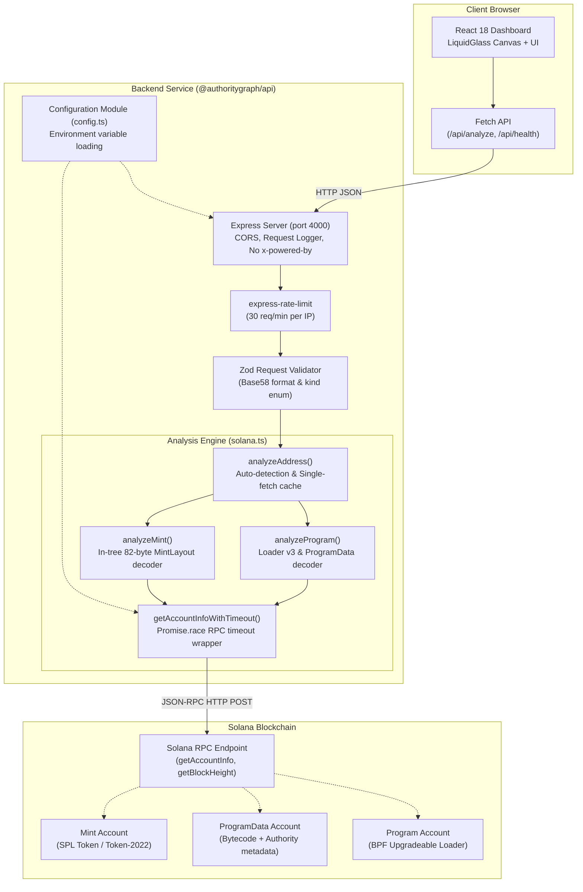

# AuthorityGraph

**Deterministic, read-only administrative control posture analyzer for the Solana blockchain.**

[](https://github.com/sarangchaudhari635-oss/Authoritygraph/actions/workflows/ci.yml)
[](https://nodejs.org/)
[](https://docs.npmjs.com/cli/using-npm/workspaces)
[](https://www.typescriptlang.org/)
[](https://solana.com/docs)
[-success.svg)](https://github.com/sarangchaudhari635-oss/Authoritygraph)
[](LICENSE)

---

## Table of Contents

- [1. Executive Summary](#1-executive-summary)
- [2. The Problem: Administrative Control Exposure in Solana](#2-the-problem-administrative-control-exposure-in-solana)
  - [Account Ownership vs. Delegated Authority](#account-ownership-vs-delegated-authority)
  - [Privileged Control Vectors](#privileged-control-vectors)
  - [A Realistic Failure Scenario](#a-realistic-failure-scenario)
- [3. The Solution](#3-the-solution)
- [4. Key Verified Features](#4-key-verified-features)
- [5. How It Works: Technical Workflow](#5-how-it-works-technical-workflow)
- [6. System Architecture](#6-system-architecture)
  - [Architecture Diagram](#architecture-diagram)
  - [Component Boundaries and Isolation](#component-boundaries-and-isolation)
  - [Architectural Decisions and Trade-offs](#architectural-decisions-and-trade-offs)
- [7. Technology Stack](#7-technology-stack)
- [8. Supported Analysis, Rule Matrix, and Limitations](#8-supported-analysis-rule-matrix-and-limitations)
  - [Supported Account Types and Decoders](#supported-account-types-and-decoders)
  - [Security Rules and Deterministic Interpretations](#security-rules-and-deterministic-interpretations)
  - [Token-2022 Handling](#token-2022-handling)
  - [Explicit Security Boundaries and Non-Guarantees](#explicit-security-boundaries-and-non-guarantees)
- [9. Ecosystem and Competitor Comparison](#9-ecosystem-and-competitor-comparison)
- [10. Example Output](#10-example-output)
  - [Example 1: Upgradeable Program with Active Upgrade Authority](#example-1-upgradeable-program-with-active-upgrade-authority)
  - [Example 2: SPL Token Mint with Active Issuance and Freeze Controls](#example-2-spl-token-mint-with-active-issuance-and-freeze-controls)
  - [Example 3: Unsupported Account Type](#example-3-unsupported-account-type)
- [11. Installation and Setup](#11-installation-and-setup)
  - [Prerequisites](#prerequisites)
  - [Repository Setup](#repository-setup)
  - [Running the Application](#running-the-application)
  - [Production Build](#production-build)
- [12. Environment Variables](#12-environment-variables)
- [13. API Reference](#13-api-reference)
  - [GET /api/health](#get-apihealth)
  - [POST /api/analyze](#post-apianalyze)
  - [Rate Limiting and Timeouts](#rate-limiting-and-timeouts)
  - [HTTP Error Reference](#http-error-reference)
- [14. Testing and Quality Assurance](#14-testing-and-quality-assurance)
  - [Verified Test Coverage](#verified-test-coverage)
  - [Running the Verification Commands](#running-the-verification-commands)
- [15. Security Model and Threat Considerations](#15-security-model-and-threat-considerations)
  - [Read-Only Guarantee](#read-only-guarantee)
  - [RPC Trust Boundaries and Fallbacks](#rpc-trust-boundaries-and-fallbacks)
  - [Fail-Closed Data Decoding](#fail-closed-data-decoding)
  - [Vulnerability Reporting](#vulnerability-reporting)
- [16. Performance and Reliability](#16-performance-and-reliability)
- [17. Deployment Guide](#17-deployment-guide)
- [18. Product Roadmap](#18-product-roadmap)
- [19. Research and Canonical References](#19-research-and-canonical-references)
- [20. Contributing](#20-contributing)
- [21. License and Acknowledgements](#21-license-and-acknowledgements)

---

## 1. Executive Summary

**AuthorityGraph** is a specialized, read-only security posture analyzer for the Solana ecosystem. It inspects on-chain accounts to identify and document administrative control relationships, specifically **program upgrade authorities** and **SPL Token mint and freeze authorities**.

Rather than outputting opaque risk scores or speculative exploit claims, AuthorityGraph acts as an evidence-first audit tool. It reads raw on-chain state directly via remote procedure call (RPC), runs deterministic binary decoders for documented account layouts, isolates sensitive authorities, and presents clear, reproducible findings alongside their exact byte-level or metadata sources.

AuthorityGraph serves five distinct stakeholder audiences:
1. **Hackathon Judges:** Evaluates clean systems engineering, rigorous RPC protocol handling, dependency risk elimination, and zero-bullshit security reporting.
2. **Solana Developers:** Provides an automated checkpoint during local and testnet deployments to verify that program upgrade and mint authorities are correctly configured or properly revoked prior to mainnet launch.
3. **Security Researchers & Auditors:** Delivers transparent, reproducible point-in-time evidence of administrative keys, eliminating manual layout parsing and CLI inspections.
4. **Open-Source Contributors:** Offers a modular, well-tested TypeScript monorepo with verified test suites, strict typing, and zero native dependency vulnerabilities.
5. **Users & Protocol Integrators:** Surfaces privileged capabilities—such as whether a token can be minted infinitely or whether a smart contract can have its bytecode rewritten overnight—before interacting with or holding an asset.

---

## 2. The Problem: Administrative Control Exposure in Solana

In decentralized systems, vulnerabilities frequently occur outside smart contract execution paths. While auditors scrutinize instruction handlers, math overflows, and reentrancy vectors, many critical protocol compromises stem from **unmonitored, misunderstood, or unrevoked administrative controls**.

### Account Ownership vs. Delegated Authority

A fundamental source of confusion in Solana security is the distinction between an account's **runtime owner** and its **administrative authorities**:

- **Account Owner (`AccountInfo.owner`):** A protocol-level runtime property that designates which program has write access to the account's data buffer. For instance, all standard SPL Token mints and accounts are owned by the Token Program (`TokenkegQfeZyiNwAJbNbGKPFXCWuBvf9Ss623VQ5DA`), and all standard executable programs are owned by the BPF Upgradeable Loader (`BPFLoaderUpgradeab1e11111111111111111111111`). An account owner is not a personal key.
- **Administrative Authority:** An address encoded *inside the account's binary data* that is recognized by the program as authorized to execute privileged operations. Examples include a token's `mint_authority` (authorized to inflate supply), a token's `freeze_authority` (authorized to halt transfers for individual token accounts), or an upgradeable program's `upgrade_authority` (authorized to deploy new BPF bytecode).

Confusing these concepts leads users to mistake the system or token program ID for a project's controller, or conversely, to overlook that a private key still holds the authority to freeze assets.

### Privileged Control Vectors

Privileged permissions are not inherently malicious—many protocols require upgradeability during rapid iteration, and fiat-backed stablecoins mandate freeze authorities for legal compliance. However, undisclosed or unmonitored privileges introduce substantial risks:

| Authority Vector | Legitimate Purpose | Operational & Security Risk |
|---|---|---|
| **Program Upgrade Authority** | Patching critical zero-day bugs; protocol feature upgrades. | A single compromised private key can replace executable bytecode with a malicious implementation that drains pool reserves. |
| **Token Mint Authority** | Controlled token release schedules; automated staking rewards. | Arbitrary supply inflation (unbounded minting) that dilutes holder equity or crashes automated market maker (AMM) pools. |
| **Token Freeze Authority** | Regulatory compliance (e.g., sanction enforcement for fiat stablecoins); preventing exploit drains during an ongoing hack. | Hostile blacklisting or "honeypots" where users can purchase tokens but are blocked from transferring or selling them. |

### A Realistic Failure Scenario

Consider a decentralized finance (DeFi) yield aggregator preparing for mainnet launch:
1. During development on Devnet, the engineering team retains a hot keypair as the program's `upgrade_authority` and the reward token's `mint_authority` to rapidly test deployment fixes.
2. Ahead of launch, marketing materials announce that the protocol is "immutable and decentralized."
3. In reality, the deployment script omitted the instruction to set the program's upgrade authority to `None` (`solana program set-upgrade-authority <PROGRAM_ID> --final`), and the reward token's mint authority was never transferred to a governance contract or revoked.
4. Months later, an engineer's laptop is compromised. Attackers locate the deployment keypair, mint billions of reward tokens into AMM pools, swap them for SOL, and deploy a modified program binary that redirects user withdrawals.

AuthorityGraph exists to expose these configurations before they become security incidents.

---

## 3. The Solution

AuthorityGraph provides an automated, deterministic analysis pipeline that evaluates Solana accounts against known on-chain schemas and surfaces administrative authorities with verifiable evidence:

```
[ Solana Address ]
        │
        ▼
[ Zod Input & Format Validation ]
        │
        ▼
[ Server-Side RPC Retrieval with Timeout ]
        │
        ▼
[ Account Classification (Executable vs. Program-Owned) ]
        │
        ├── Executable (Loader v3) ──► Decode ProgramData ──► Extract Upgrade Authority
        ├── Token / Token-2022     ──► 82-byte MintLayout  ──► Extract Mint & Freeze Authorities
        └── Other Account Types    ──► Fail-Closed `unsupported` State
        │
        ▼
[ Rule Engine: Deterministic Findings + Limitations + Recommendations ]
        │
        ▼
[ JSON API & Liquid Glass Web Dashboard ]
```

1. **Input Submission:** A user submits a 32-to-44 character base58 Solana public key (program ID or token mint address) via the web dashboard or REST API.
2. **Account Retrieval:** The backend securely requests the account state from the configured Solana RPC cluster, guarded by request-level timeouts and IP rate limits.
3. **Classification & Validation:** The analyzer verifies account existence, checks the `executable` boolean flag, and inspects the `owner` field against supported loader and token program IDs.
4. **Deterministic Decoding:**
   - For programs: Verifies the Loader v3 enum tag, reads the `ProgramData` pointer, fetches the corresponding ProgramData account, reads the deployment slot, and extracts the upgrade authority pubkey if present.
   - For mints: Enforces account size constraints (rejecting 165-byte token accounts), parses the 82-byte binary layout using an in-tree decoder, and extracts mint and freeze authority options.
5. **Evidence-Backed Findings:** Findings are generated with explicit statuses (`present` or `absent`), severity indicators, exact evidence strings (including deployment slots, supply, and source account addresses), actionable recommendations, and documented limitations.
6. **Explicit Uncertainty:** If an account belongs to an unsupported loader, is not initialized, uses unsupported layouts, or contains Token-2022 extensions, the system explicitly returns an `unsupported` result code or emits documented warnings rather than guessing safety.

---

## 4. Key Verified Features

Every feature listed below is verified against the current repository implementation:

- **Program Upgrade Authority Analysis:**
  - *What it does:* Inspects executable accounts owned by the Solana BPF Upgradeable Loader (`BPFLoaderUpgradeab1e11111111111111111111111`), resolves the associated `ProgramData` account, and extracts the recorded upgrade authority.
  - *Why it matters:* Distinguishes truly immutable programs from those whose code can be modified at will by a single key.
  - *Evidence produced:* Returns `upgradeAuthority` pubkey (or `null` if immutable), the `ProgramData` account pubkey, and the on-chain deployment slot.
- **SPL Token Mint Authority Analysis:**
  - *What it does:* Parses SPL Token and Token-2022 mint accounts using an 82-byte binary decoder to determine whether ongoing token issuance is active.
  - *Why it matters:* Alerts users and integrators to whether token supply can be inflated arbitrarily.
  - *Evidence produced:* Returns `mintAuthority` pubkey (or `null` if revoked), token decimal precision, and current total supply.
- **SPL Token Freeze Authority Analysis:**
  - *What it does:* Decodes the freeze authority option and address from SPL Token and Token-2022 mint accounts.
  - *Why it matters:* Identifies whether an administrative key can freeze token accounts, preventing transfers and trading.
  - *Evidence produced:* Returns `freezeAuthority` pubkey (or `null` if revoked) and token program identity.
- **Token-2022 Full Extension TLV Analyzer:**
  - *What it does:* Scans the Type-Length-Value (TLV) extension buffer beyond byte 165 for Token-2022 mint accounts. Fully decodes `PermanentDelegate` (type #13), `DefaultAccountState` (type #4), `TransferHook` (type #14), `TransferFeeConfig` (type #1), `MintCloseAuthority` (type #2), `InterestBearingConfig` (type #10), and `NonTransferable` (type #9).
  - *Why it matters:* Identifies high-risk privileges (e.g. permanent delegates able to seize holder tokens without signature) that standard SPL Token tools miss entirely.
  - *Evidence produced:* Returns decoded extension fields, authority pubkeys, fees in basis points, and specific findings.
- **Effective Authority Resolver & Squads Multisig Adapter:**
  - *What it does:* Analyzes authority accounts to determine their controlling nature: direct keypair (`direct-key`), recognized Squads multisig (`squads-multisig`), unknown program-owned (`unknown-program-owned`), or unresolved. Automatically identifies Squads v3 & v4 multisigs using on-chain account discriminators and Borsh layouts, decoding approval threshold and member count.
  - *Why it matters:* Discloses whether an upgrade or mint authority is a single hot key or a decentralized multisig, and flags dangerous 1-of-N threshold configurations.
  - *Evidence produced:* Returns `authorityType`, `multisigThreshold`, `multisigMemberCount`, and controlling program ID.
- **Directed Authority Control Graph:**
  - *What it does:* Constructs a normalized directed graph linking the target asset to its upgrade authorities, mint/freeze authorities, Token-2022 delegates, and controlling multisigs. Rendered interactively in the web dashboard.
  - *Why it matters:* Visualizes administrative flow and multi-hop governance at a glance.
- **Security Policy & Configuration Drift Engine:**
  - *What it does:* Evaluates on-chain configurations against configurable security policies with explicit `PASS`, `FAIL`, `UNKNOWN`, and `NOT_APPLICABLE` states.
  - *Why it matters:* Automates compliance checks against rules like "must be immutable", "multisig threshold >= 2", "no permanent delegate", and "whitelisted upgrade authorities".
- **Historical Snapshots & Change Detection:**
  - *What it does:* Persists observation snapshots with deterministic SHA-256 state hashes, compares historical configurations, and detects events: authority handovers, immutability transitions, threshold adjustments, and extension modifications.
  - *Why it matters:* Enables monitoring and alerting on administrative drift over time.
- **Fail-Closed Account Type Guarding:**
  - *What it does:* Enforces strict account validation: rejects non-base58 inputs, flags non-executable accounts submitted as programs, and rejects 165-byte token accounts submitted to the mint endpoint.
  - *Why it matters:* Prevents silent misinterpretation of user token accounts as mints or non-executable accounts as contracts.
- **Zero-Dependency Security (Vulnerability Elimination):**
  - *What it does:* Operates with zero transitive CVEs by replacing high-vulnerability packages with clean, audited in-tree binary decoders.
  - *Status:* `npm audit` reports **0 vulnerabilities**.
  - *What it does:* Uses an in-tree binary buffer decoder (`MintLayout`) rather than importing `@solana/spl-token`.
  - *Why it matters:* Eliminates transitive CVEs from outdated packages (`stream-json`, `uuid`) and resolves cross-version `@solana/web3.js` `PublicKey` compatibility crashes.
  - *Evidence produced:* Verified by `npm audit` reporting 0 vulnerabilities and 25 dedicated decoder unit tests.
- **Server-Side RPC Protection & Abuse Prevention:**
  - *What it does:* Isolates RPC endpoints server-side; applies IP-based rate limiting (30 requests/minute via `express-rate-limit`), request timeouts (15s HTTP timeout, 12s RPC timeout), and disables `x-powered-by` fingerprinting.
  - *Why it matters:* Prevents RPC key exposure in frontend bundles and protects infrastructure from rate exhaustion and denial-of-service.

---

## 5. How It Works: Technical Workflow

```mermaid
sequenceDiagram
    autonumber
    actor User as User / Client
    participant Web as Web Dashboard (Vite)
    participant API as Express API (/api/analyze)
    participant Zod as Zod Schema Validator
    participant Solana as Solana Adapter (solana.ts)
    participant RPC as Solana RPC Node

    User->>Web: Input address & select analysis mode (auto/program/mint)
    Web->>API: POST /api/analyze { address, kind }
    API->>Zod: Validate address format (32-44 base58 chars) & kind
    alt Validation Failure
        Zod-->>API: ValidationError
        API-->>Web: HTTP 400 INVALID_REQUEST / INVALID_ADDRESS
    end
    API->>Solana: analyzeAddress(address, kind)
    Solana->>RPC: getAccountInfo(pubkey, "confirmed") [Promise.race timeout]
    alt Account Not Found
        RPC-->>Solana: null
        Solana-->>API: AnalysisResponse (result: "unsupported", summary: "No account found")
    else Account Found
        RPC-->>Solana: AccountInfo { executable, owner, data }
        alt Kind is "auto" (Route by Account Properties)
            alt executable == true
                Note over Solana: Route to analyzeProgram()
            else owner in [Token, Token-2022]
                Note over Solana: Route to analyzeMint()
            else Other Owner
                Solana-->>API: AnalysisResponse (result: "unsupported", unanalyzed owner)
            end
        end
        alt Program Analysis Workflow
            Note over Solana: Verify owner == BPFLoaderUpgradeab1e...
            Note over Solana: Verify program tag == 2 & read ProgramData pubkey
            Solana->>RPC: getAccountInfo(programDataPubkey, "confirmed")
            RPC-->>Solana: ProgramData AccountInfo { data }
            Note over Solana: Verify tag == 3, read deployment slot, read option tag
            Note over Solana: If option == 1 -> extract upgrade authority; if 0 -> immutable
        else Mint Analysis Workflow
            Note over Solana: Guard against data.length == 165 (token account)
            Note over Solana: Decode 82-byte MintLayout (mint/freeze options + pubkeys)
            Note over Solana: If owner == Token-2022 -> append extension caveat warning
        end
        Solana-->>API: AnalysisResponse { findings, evidence, warnings, observedAt }
    end
    API-->>Web: HTTP 200 OK (JSON AnalysisResponse)
    Web->>User: Render findings, severity pills, evidence, and recommendations
```

---

## 6. System Architecture

AuthorityGraph is structured as an npm workspaces monorepo containing two decoupled packages: `@authoritygraph/api` (the backend analysis service) and `@authoritygraph/web` (the browser interface).

### Architecture Diagram



### Component Boundaries and Isolation

- **Frontend Isolation (`apps/web`):** The React frontend never holds RPC credentials, never directly queries third-party RPC endpoints, and contains no transaction signing logic or wallet adapters. In development, Vite transparently proxies `/api/*` requests to `http://localhost:4000`.
- **Backend Isolation (`apps/api`):** The Express API acts as a secure intermediary. It enforces request schemas, sanitizes errors before responding to the client, prevents internal RPC connection strings from leaking, logs request durations in structured JSON, and enforces timeouts on remote RPC interactions.
- **Fail-Closed Boundary:** All binary decoding operations are guarded by explicit buffer length checks. If an account's data buffer does not match expected layouts, the system catches the error and marks the account `unsupported` rather than returning incomplete findings.

### Architectural Decisions and Trade-offs

1. **In-Tree Decoder vs. `@solana/spl-token` Dependency:**
   - *Decision:* Replaced `@solana/spl-token` with an internal 82-byte buffer decoder (`MintLayout`) in `apps/api/src/solana.ts`.
   - *Rationale:* The official `@solana/spl-token` v0.1.8 pulled in transitive dependencies (`stream-json`, `uuid`) with unresolved CVEs and bundled a conflicting `@solana/web3.js` v1 instance that caused runtime `.equals()` crashes when comparing public keys. The manual decoder eliminates all transitive CVEs and guarantees v3 compatibility.
2. **Read-Only / No Wallet Connection:**
   - *Decision:* Intentionally omitted wallet adapter integration (`@solana/wallet-adapter`).
   - *Rationale:* AuthorityGraph is an inspection and posture analysis utility. Requiring wallet connections introduces unnecessary user friction, browser extension attack surfaces, and user skepticism. Public on-chain data requires zero authentication.
3. **Stateless Service vs. Database Persistence:**
   - *Decision:* Implemented as a completely stateless API without a database, queue, or Redis cache for the MVP.
   - *Rationale:* Every query represents a real-time, point-in-time check. Avoiding caching prevents serving stale authority records after an upgrade or revocation event has occurred on-chain. Caching and historical snapshots are reserved for the roadmap once subscription monitoring is added.
4. **`Promise.race` RPC Timeout Limitation:**
   - *Trade-off:* `getAccountInfoWithTimeout` wraps `connection.getAccountInfo` using `Promise.race` with an unref'd timer.
   - *Nuance:* While `Promise.race` stops the caller from blocking when an RPC provider hangs, it does not abort the underlying Node.js HTTP socket because `@solana/web3.js` v3 does not expose an `AbortSignal` parameter for `getAccountInfo`. The socket drains in the background.

---

## 7. Technology Stack

All versions and packages are verified directly from repository configuration manifests:

### Frontend (`apps/web`)
| Package / Technology | Version | Purpose |
|---|---|---|
| **React** | `^18.3.1` | User interface rendering and state management |
| **React DOM** | `^18.3.1` | React browser DOM bindings |
| **Vite** | `^6.0.7` | High-performance build tool and local dev server with proxy support |
| **Tailwind CSS** | `^4.3.3` | Utility styling engine |
| **@tailwindcss/postcss** | `^4.3.3` | PostCSS plugin for Tailwind CSS v4 |
| **Lucide React** | `^0.468.0` | Accessible SVG security and audit icons |
| **TypeScript** | `^5.7.3` | Static type safety for frontend components |
| **Vitest** | `^5.0.3` | Unit test runner configured with `--passWithNoTests` |

### Backend (`apps/api`)
| Package / Technology | Version | Purpose |
|---|---|---|
| **Node.js** | `>=20` (`v24.11.1` in audit) | Server runtime environment |
| **Express** | `^4.21.2` | Minimal HTTP server and routing engine |
| **@solana/web3.js** | `^3.0.2` | Core Solana blockchain RPC client and cryptography |
| **Zod** | `^3.24.1` | Runtime request body schema validation |
| **express-rate-limit** | `^8.7.1` | IP-based request rate limiting (protects RPC quotas) |
| **cors** | `^2.8.5` | Cross-Origin Resource Sharing control |
| **dotenv** | `^16.4.7` | Environment variable management |
| **tsx** | `^4.19.3` | TypeScript execution and hot-reloading development engine |

### Testing & Tooling
| Package / Technology | Version | Purpose |
|---|---|---|
| **Vitest** | `^5.0.3` | Unit and integration test runner |
| **Supertest** | `^7.3.1` | HTTP integration test harness for Express |
| **Concurrently** | `^9.1.2` | Workspace script runner orchestrating API and Web servers |
| **GitHub Actions** | `ubuntu-latest` | Continuous integration pipeline (`.github/workflows/ci.yml`) |

---

## 8. Supported Analysis, Rule Matrix, and Limitations

### Supported Account Types and Decoders

| Account Category | Program Owner / Identifier | Supported Layouts | Extracted Evidence |
|---|---|---|---|
| **Upgradeable Program** | `BPFLoaderUpgradeab1e11111111111111111111111` | `UpgradeableLoaderState::Program` (tag `2`) and `ProgramData` (tag `3`) | Direct `upgrade_authority` pubkey (or `null`), deployment slot, `ProgramData` account address. |
| **SPL Token Mint** | `TokenkegQfeZyiNwAJbNbGKPFXCWuBvf9Ss623VQ5DA` | Standard 82-byte SPL Mint Layout | `mint_authority` pubkey (or `null`), `freeze_authority` pubkey (or `null`), decimals, total supply. |
| **Token-2022 Mint** | `TokenzQdBNbLqP5VEhdkAS6EPFLC1PHnBqCXEpPxuEb` | Base 82-byte Mint Layout (extensions unparsed) | Base `mint_authority` and `freeze_authority`; appends extension warning. |
| **Other Loaders** | e.g. `BPFLoader2111111111111111111111111111111111` | Not decoded | Classified as `PROGRAM_LOADER_UNSUPPORTED`. |
| **Token Accounts** | `Tokenkeg...` (165 bytes) | Explicitly rejected | Rejects 165-byte accounts with explicit user warning. |
| **System / PDA Accounts** | `11111111111111111111111111111111` / Arbitrary | Not decoded | Classified as `unsupported` account type. |

### Security Rules and Deterministic Interpretations

Rules represent deterministic observations of on-chain state. Severity ratings are structured prompts for security review, not probabilities of exploitation:

| Rule ID | Subject | Condition | Severity | Meaning & Recommendation |
|---|---|---|---|---|
| `PROGRAM_UPGRADE_AUTHORITY_ACTIVE` | Upgradeable Program | `ProgramData` option tag is `1` and contains a 32-byte pubkey | **High** | Program bytecode can be updated by this address. Verify custody, multisig thresholds, and timelocks. |
| `PROGRAM_IMMUTABLE` | Upgradeable Program | `ProgramData` option tag is `0` (`null`) | **Info** | Program cannot be upgraded via BPF loader. Retain deployment evidence. |
| `PROGRAM_LOADER_UNSUPPORTED` | Executable Account | Owned by a loader other than Loader v3 | **Unknown** | The program is executable, but its loader format is outside MVP scope. Inspect manually. |
| `ACCOUNT_NOT_EXECUTABLE` | Address input as Program | Account metadata has `executable: false` | **Info** | Provided address is not an executable program on this cluster. |
| `TOKEN_MINT_AUTHORITY_ACTIVE` | SPL Token Mint | Mint layout option tag is non-zero | **Medium** | Ongoing token issuance is permitted. Confirm whether supply inflation is intended. |
| `TOKEN_MINT_AUTHORITY_REVOKED` | SPL Token Mint | Mint layout option tag is `0` | **Info** | Token mint authority is permanently renounced. No further tokens can be created. |
| `TOKEN_FREEZE_AUTHORITY_ACTIVE` | SPL Token Mint | Freeze layout option tag is non-zero | **Medium** | Token accounts can be frozen by the authority. Confirm operational and legal rationale. |
| `TOKEN_FREEZE_AUTHORITY_REVOKED` | SPL Token Mint | Freeze layout option tag is `0` | **Info** | Freeze capability is revoked. Token transfers cannot be halted by a freeze authority. |

### Token-2022 Handling

Solana's Token Extensions program (`Token-2022`) allows tokens to configure additional byte layouts appended after the base 82-byte mint structure. 

**Current MVP Scope:**
- AuthorityGraph safely reads and decodes the initial 82 bytes (decimals, supply, mint authority, and freeze authority).
- It **does not** parse extensions such as:
  - `PermanentDelegate` (allows a key to transfer or burn tokens from any account)
  - `TransferHook` (executes custom program logic on every transfer)
  - `DefaultAccountState` (can cause all new token accounts to be frozen by default)
  - `TransferFeeConfig` (enforces transfer taxes)
  - `ConfidentialTransfers` (zero-knowledge balances)
- When a Token-2022 mint is analyzed, AuthorityGraph automatically appends this verified warning to the response:
  > *"This account uses the Token-2022 program. Extensions such as PermanentDelegate, TransferHook, DefaultAccountState, InterestBearingConfig, and others are NOT decoded by this MVP. The findings below reflect base mint fields (mint authority, freeze authority) only. Review on-chain extension data independently before making security judgements."*

### Explicit Security Boundaries and Non-Guarantees

To prevent misleading users or evaluators, AuthorityGraph operates under strict security boundaries:
1. **Detected Authority $\neq$ Exploitability:** Finding an active upgrade authority or mint authority does not mean a contract is vulnerable or that a project is a scam. It indicates where administrative power currently resides.
2. **Absent Authority $\neq$ Absolute Safety:** A token with revoked mint and freeze authorities or an immutable program may still contain catastrophic smart contract logic flaws, economic drain vectors, or oracle manipulation vulnerabilities.
3. **No Direct Identity Attribution:** AuthorityGraph does not resolve a public key to an individual, company, or legal identity. A direct authority address might belong to a single hardware wallet, a burner key, a Squads multisig, or a governance Program Derived Address (PDA).
4. **Point-in-Time Observation:** On-chain state can change in the slot following analysis. Findings represent point-in-time observations.

---

## 9. Ecosystem and Competitor Comparison

To contextualize AuthorityGraph within the Solana ecosystem, the following comparison highlights differences in scope, automation, and reporting:

| Dimension / Feature | **AuthorityGraph** (This Project) | **Solana Explorer** (`explorer.solana.com`) | **Solscan** (`solscan.io`) | **RugCheck** (`rugcheck.xyz`) | **Sec3 / Soteria** (`sec3.dev`) |
|---|---|---|---|---|---|
| **Primary Focus** | Evidence-backed administrative posture analysis | General blockchain transaction & account browsing | Commercial explorer with token & account analytics | Retail token & memecoin risk scoring | Full-lifecycle enterprise smart contract audits & runtime monitoring |
| **Target Audience** | Developers, auditors, researchers, protocol evaluators | General Solana users & developers | General Solana users & traders | Retail token traders & liquidity providers | Enterprise protocol teams & institutions |
| **Program Upgrade Analysis** | **Yes** — Decodes Loader v3 & ProgramData deployment slot | **Yes** — Displays raw metadata field | **Yes** — Displays upgrade authority field | **No** — Token mint focus only | **Yes** — Comprehensive program audit |
| **Token Mint / Freeze Analysis** | **Yes** — In-tree 82-byte binary decoder | **Yes** — Displays raw mint fields | **Yes** — Displays raw mint fields | **Yes** — Primary focus | **Yes** — As part of full protocol reviews |
| **Direct Evidence vs. Heuristic Score** | **Direct Evidence** — Raw pubkeys, deployment slots, byte checks; zero heuristic scores | **Direct Evidence** — Displays raw RPC values | **Direct Evidence** — Displays raw RPC values | **Heuristic Score** — Generates "Good" / "Danger" risk scores | **Formal Findings** — Detailed vulnerability audit reports |
| **Token-2022 Caveats** | **Explicit Warning** stating extensions are unparsed | Shows raw extension data where supported | Shows raw extension data where supported | Partial extension analysis | Full deep audit coverage |
| **API Integration** | **Yes** — Lightweight REST JSON API with rate limiting | **No** — Direct RPC queries only | Commercial API (tiered pricing) | Public / semi-private API | Enterprise SaaS integration |
| **Dependencies / Open Source** | **100% Open Source**, zero transitive CVEs, in-tree decoders | Open source web client | Proprietary / Closed source | Proprietary risk engine | Proprietary scanner / audit services |
| **Wallet Connection Required** | **No** — 100% read-only public queries | Optional for user transactions | Optional | Optional | Not applicable |

### Differentiation Summary
AuthorityGraph avoids speculative scoring algorithms ("92/100 Safety Score") that create a false sense of security. Instead, it provides a deterministic, transparent, and auditable bridge between raw Solana RPC byte data and human-understandable security recommendations.

---

## 10. Example Output

The following examples represent actual JSON payloads returned by `POST /api/analyze`, conforming strictly to `AnalysisResponse` in `apps/api/src/types.ts`.

### Example 1: Upgradeable Program with Active Upgrade Authority

```json
{
  "address": "MarBmsSgKXdrN1egZf5sqe1TMai9K1rChYNDJgjq7aD",
  "kind": "program",
  "cluster": "mainnet-beta",
  "observedAt": "2026-10-11T12:00:00.000Z",
  "result": "findings",
  "summary": "Analysis completed. Review each finding and its evidence.",
  "findings": [
    {
      "id": "PROGRAM_UPGRADE_AUTHORITY_ACTIVE",
      "title": "Program has an active upgrade authority",
      "severity": "high",
      "status": "present",
      "summary": "An address is recorded as the authority able to upgrade this program under the decoded loader layout.",
      "evidence": [
        {
          "source": "Solana RPC account data",
          "accountAddress": "7vhKRLR5j5nsiubQbtod8TsrmX81sFk8fG417fs1U49a",
          "observedValue": "4ndr9BY6vdVjyrGgKEmL716rT1bK59VjC8vT7w4r3qQp",
          "detail": "ProgramData=7vhKRLR5j5nsiubQbtod8TsrmX81sFk8fG417fs1U49a; deploymentSlot=215489120; direct authority only."
        }
      ],
      "recommendation": "Verify the authority's custody, approval policy, recovery process, and whether the trust model is documented.",
      "limitations": [
        "This does not determine who controls the key or whether it is protected by a multisig."
      ]
    }
  ],
  "warnings": [
    "This report describes observed on-chain configuration, not confirmed exploitability.",
    "Only supported account types and direct authorities are analyzed in this MVP."
  ]
}
```

### Example 2: SPL Token Mint with Active Issuance and Freeze Controls

```json
{
  "address": "EPjFWdd5AufqSSqeM2qN1xzybapC8G4wEGGkZwyTDt1v",
  "kind": "mint",
  "cluster": "mainnet-beta",
  "observedAt": "2026-10-11T12:00:00.000Z",
  "result": "findings",
  "summary": "Analysis completed. Review each finding and its evidence.",
  "findings": [
    {
      "id": "TOKEN_MINT_AUTHORITY_ACTIVE",
      "title": "Mint authority is active",
      "severity": "medium",
      "status": "present",
      "summary": "An address is recorded as able to mint additional tokens.",
      "evidence": [
        {
          "source": "Solana RPC account data",
          "accountAddress": "EPjFWdd5AufqSSqeM2qN1xzybapC8G4wEGGkZwyTDt1v",
          "observedValue": "BJEHGokMmcvuTvnR2g6XyS2eH3qFhL32RzT6xV7qW8b",
          "detail": "Token program=TokenkegQfeZyiNwAJbNbGKPFXCWuBvf9Ss623VQ5DA; decimals=6; supply=32450819234812340."
        }
      ],
      "recommendation": "Confirm whether ongoing issuance is intended and document the authority's custody and approval controls."
    },
    {
      "id": "TOKEN_FREEZE_AUTHORITY_ACTIVE",
      "title": "Freeze authority is active",
      "severity": "medium",
      "status": "present",
      "summary": "An address is recorded as able to freeze token accounts under the supported token program.",
      "evidence": [
        {
          "source": "Solana RPC account data",
          "accountAddress": "EPjFWdd5AufqSSqeM2qN1xzybapC8G4wEGGkZwyTDt1v",
          "observedValue": "BJEHGokMmcvuTvnR2g6XyS2eH3qFhL32RzT6xV7qW8b",
          "detail": "Token program=TokenkegQfeZyiNwAJbNbGKPFXCWuBvf9Ss623VQ5DA."
        }
      ],
      "recommendation": "Confirm the operational and legal purpose of freezing, and disclose the policy to token holders."
    }
  ],
  "warnings": [
    "This report describes observed on-chain configuration, not confirmed exploitability.",
    "Only supported account types and direct authorities are analyzed in this MVP."
  ]
}
```

### Example 3: Unsupported Account Type

```json
{
  "address": "11111111111111111111111111111111",
  "kind": "unknown",
  "cluster": "mainnet-beta",
  "observedAt": "2026-10-11T12:00:00.000Z",
  "result": "unsupported",
  "summary": "This account type is not supported by the current MVP.",
  "findings": [],
  "warnings": [
    "This report describes observed on-chain configuration, not confirmed exploitability.",
    "Only supported account types and direct authorities are analyzed in this MVP.",
    "Observed account owner: 11111111111111111111111111111111"
  ]
}
```

---

## 11. Installation and Setup

### Prerequisites

- **Node.js:** `>= 20.0.0` (tested on Node.js `v24.11.1`)
- **Package Manager:** `npm >= 10.0.0`
- **Solana RPC Endpoint:** A dedicated endpoint (e.g., from Helius, QuickNode, Triton, or Alchemy) is recommended. The fallback public endpoint (`https://api.mainnet-beta.solana.com`) is heavily rate-limited and unsuitable for high volume.

### Repository Setup

1. **Clone the repository:**
   ```bash
   git clone https://github.com/sarangchaudhari635-oss/Authoritygraph.git
   cd Authoritygraph
   ```

2. **Install monorepo dependencies:**
   ```bash
   npm install
   ```
   *Note: This installs dependencies across the root, `apps/api`, and `apps/web` workspaces using npm workspaces.*

3. **Configure API environment variables:**
   ```bash
   # From the repository root
   cp .env.example apps/api/.env
   ```
   Open `apps/api/.env` in your text editor and set your RPC endpoint:
   ```ini
   PORT=4000
   SOLANA_RPC_URL=https://mainnet.helius-rpc.com/?api-key=YOUR_ACTUAL_API_KEY
   SOLANA_CLUSTER=mainnet-beta
   CORS_ORIGIN=http://localhost:5173
   REQUEST_TIMEOUT_MS=12000
   NODE_ENV=development
   ```

### Running the Application

AuthorityGraph provides two concurrent development workflows:

#### Option A: Unified Launcher (Single Terminal)
Runs both the Express API and Vite web dev servers concurrently:
```bash
npm run dev
```
- **API Server:** `http://localhost:4000`
- **Web Dashboard:** `http://localhost:5173`

#### Option B: Independent Workspaces (Separate Terminals)
Useful for targeted backend debugging or frontend UI iteration:

- **Terminal 1 (API Server):**
  ```bash
  npm run dev -w @authoritygraph/api
  ```
- **Terminal 2 (Web Dashboard):**
  ```bash
  npm run dev -w @authoritygraph/web
  ```

### Production Build

To compile both the API TypeScript bundle into `apps/api/dist/` and the Vite frontend bundle into `apps/web/dist/`:
```bash
npm run build
```

To run the compiled production backend server:
```bash
cd apps/api
NODE_ENV=production npm run start
```

---

## 12. Environment Variables

AuthorityGraph strictly isolates backend secrets from frontend assets. Environment variables are loaded in `apps/api/src/config.ts`:

| Variable Name | Required? | Default / Fallback | Type | Description & Operational Behavior |
|---|---|---|---|---|
| `PORT` | No | `4000` | Integer | TCP port on which the Express API server listens. |
| `SOLANA_RPC_URL` | Recommended | `https://api.mainnet-beta.solana.com` | URL (Secret) | Solana JSON-RPC endpoint. **Keep secret.** If unset, a console warning is emitted and the public cluster endpoint is used (subject to strict 429 rate limits). |
| `SOLANA_CLUSTER` | No | `mainnet-beta` | String | Cluster identifier tag returned in analysis responses (e.g., `mainnet-beta`, `devnet`, `testnet`). |
| `CORS_ORIGIN` | No | `http://localhost:5173` | URL | Allowed origin for Cross-Origin Resource Sharing. Emits a security warning if set to `localhost` when `NODE_ENV === "production"`. |
| `REQUEST_TIMEOUT_MS` | No | `12000` | Milliseconds | Individual RPC call timeout enforced via `getAccountInfoWithTimeout`. |
| `NODE_ENV` | No | `development` | String | Runtime environment (`development`, `production`, `test`). Suppresses port binding during integration testing. |
| `VITE_API_URL` | Optional | *(relative in dev)* | URL (Public) | Configured in `apps/web/.env` if the frontend is hosted on a separate CDN/domain from the API. In local dev, Vite automatically proxies `/api` to `localhost:4000`. |

> [!WARNING]
> Never commit `apps/api/.env` or `apps/web/.env` to version control. Both are excluded by the root `.gitignore`.

---

## 13. API Reference

The backend exposes a lightweight, strictly validated REST interface.

### GET `/api/health`

Evaluates service health and performs a live RPC reachability probe.

- **Method:** `GET`
- **Headers:** None required
- **Success Status:** `200 OK` (when RPC is reachable)
- **Degraded Status:** `503 Service Unavailable` (when RPC is unreachable or times out)

**Example Request:**
```bash
curl -X GET http://localhost:4000/api/health
```

**Success Response (`200 OK`):**
```json
{
  "status": "ok",
  "service": "authoritygraph-api",
  "cluster": "mainnet-beta",
  "rpcConnected": true,
  "timestamp": "2026-10-11T12:00:00.000Z"
}
```

---

### POST `/api/analyze`

Analyzes a Solana address and returns structured findings, evidence, warnings, and recommendations.

- **Method:** `POST`
- **Headers:** `Content-Type: application/json`
- **Body Schema (Zod):**
  - `address` (string, required): 32 to 44 base58 characters.
  - `kind` (string, optional): `"auto"` (default), `"program"`, or `"mint"`.

**Example Request:**
```bash
curl -X POST http://localhost:4000/api/analyze \
  -H "Content-Type: application/json" \
  -d '{"address": "MarBmsSgKXdrN1egZf5sqe1TMai9K1rChYNDJgjq7aD", "kind": "auto"}'
```

**Response Format:**
Returns an `AnalysisResponse` JSON object with HTTP `200 OK` (even when `result` is `"unsupported"`, indicating the account was safely read but is outside the MVP layout scope).

---

### GET `/api/snapshots/:address`

Retrieves historical observation snapshots for an address.

- **Method:** `GET`
- **Params:** `address` (32 to 44 base58 characters)
- **Response Format:**
  ```json
  {
    "address": "EPjFWdd5AufqSSqeM2qN1xzybapC8G4wEGGkZwyTDt1v",
    "count": 2,
    "snapshots": [...]
  }
  ```

---

### GET `/api/snapshots/:address/history`

Retrieves configuration drift timeline and detected change events across sequential snapshots.

- **Method:** `GET`
- **Params:** `address`
- **Response Format:**
  ```json
  {
    "address": "EPjFWdd5AufqSSqeM2qN1xzybapC8G4wEGGkZwyTDt1v",
    "count": 2,
    "hasHistory": true,
    "comparisons": [...],
    "allChanges": [
      {
        "type": "AUTHORITY_REMOVED",
        "field": "freezeAuthority",
        "previousValue": "7C4gPZNV9uqXZTahBamhkvSmCrqmAipj2RnvPNTitCqd",
        "currentValue": null,
        "severity": "info",
        "description": "Freeze authority was revoked.",
        "timestamp": "2026-10-11T12:00:00.000Z"
      }
    ]
  }
  ```

---

### POST `/api/compare`

Compares two arbitrary snapshots or two recent observations for an address.

- **Method:** `POST`
- **Body:** `{ "previousSnapshot": {...}, "currentSnapshot": {...} }` or `{ "address": "..." }`
- **Response Format:** Returns a `SnapshotComparison` object with `hasChanges: boolean` and `changes: ChangeEvent[]`.

---

### POST `/api/policy/evaluate`

Evaluates an `AnalysisResponse` against a configured security policy (e.g. baseline or strict immutability).

- **Method:** `POST`
- **Body:** `{ "analysis": {...}, "policy": {...} }`
- **Response Format:** Returns a `PolicyEvaluation` object with overall `status: "PASS" | "FAIL" | "UNKNOWN"`, rule results, reasons, and evidence.

---

### Rate Limiting and Timeouts

- **Rate Limit:** Guarded by `express-rate-limit`. Requests to `/api/analyze` and `/api/compare` are capped at **30 requests per IP per minute**. Exceeding this returns HTTP `429 Too Many Requests`:
  ```json
  {
    "error": "RATE_LIMITED",
    "message": "Too many requests. Please wait before retrying."
  }
  ```
- **HTTP Request Timeout:** Enforced at **15 seconds** per request. If downstream RPC calls stall, the server returns HTTP `504 Gateway Timeout`:
  ```json
  {
    "error": "TIMEOUT",
    "message": "The analysis timed out. The RPC provider may be slow or unreachable."
  }
  ```
- **RPC Call Timeout:** Individual RPC calls are bounded by `REQUEST_TIMEOUT_MS` (default 12s) using `Promise.race`.

---

### HTTP Error Reference

| HTTP Code | Error Key | Cause | Returned Body Shape |
|---|---|---|---|
| `400` | `INVALID_REQUEST` | Address string length out of range (not 32-44 chars) or invalid kind. | `{"error": "INVALID_REQUEST", "message": "...", "details": {...}}` |
| `400` | `INVALID_ADDRESS` | String is not a valid base58 public key. | `{"error": "INVALID_ADDRESS", "message": "The address could not be parsed as a Solana public key."}` |
| `404` | `NOT_FOUND` | Unrecognized route. | `{"error": "NOT_FOUND", "message": "Route not found."}` |
| `429` | `RATE_LIMITED` | Exceeded 30 requests per minute per IP. | `{"error": "RATE_LIMITED", "message": "Too many requests. Please wait before retrying."}` |
| `502` | `ANALYSIS_FAILED` | Upstream RPC node error, network failure, or rate exhaustion. | `{"error": "ANALYSIS_FAILED", "message": "The analysis could not be completed. The RPC provider may be unavailable or rate-limited."}` |
| `504` | `TIMEOUT` | Request exceeded 15s timeout ceiling. | `{"error": "TIMEOUT", "message": "The analysis timed out. The RPC provider may be slow or unreachable."}` |

---

## 14. Testing and Quality Assurance

AuthorityGraph enforces strict quality gates across both workspaces. All test suites operate against **mocked RPC fixtures** and **deterministic binary buffers**, ensuring tests run fast, reliably, and offline without incurring RPC costs or flaky network failures.

### Verified Test Coverage

The repository maintains **98 automated tests** across 9 test suites:

1. **Token-2022 Extension TLV Parser Tests (`apps/api/src/token2022.test.ts` — 30 tests):**
   - TLV header parsing, extension bounds validation, empty account handling, and truncation guards.
   - Decoders for `PermanentDelegate`, `DefaultAccountState`, `TransferHook`, `TransferFeeConfig`, `MintCloseAuthority`, `InterestBearingConfig`, and `NonTransferable`.
2. **Decoder & Layout Unit Tests (`apps/api/src/solana.test.ts` — 25 tests):**
   - Buffer conversion & LE integer read verification (`readUInt32LE`, `readBigUInt64LE`).
   - Loader v3 `Program` layout enum tag `2` and `ProgramData` address extraction.
   - Loader v3 `ProgramData` enum tag `3`, deployment slot, and `Option<Pubkey>` authority parsing.
   - Fail-closed behavior on truncated buffers (< 36 bytes for Program, < 13 bytes for ProgramData, truncated authority option).
   - In-tree 82-byte `MintLayout` decoder: active vs. revoked mint authorities, active vs. revoked freeze authorities, supply decoding, and decimal precision.
   - Cross-version `@solana/web3.js` `PublicKey.equals()` equality checks.
3. **Authority Resolver Tests (`apps/api/src/authority-resolver.test.ts` — 10 tests):**
   - System Program direct-key resolution.
   - Squads v3 & v4 multisig discriminator matching and threshold/member layout parsing.
   - Unknown program-owned account classification and uninitialized account handling.
   - Bounded RPC call timeout propagation.
4. **HTTP Server Integration Tests (`apps/api/src/server.test.ts` — 10 tests):**
   - `GET /api/health` success with mocked `getBlockHeight`.
   - `POST /api/analyze` 400 rejection on short/malformed address.
   - `POST /api/analyze` handling of invalid public key bytes.
   - `POST /api/analyze` response structure on non-existent accounts.
   - `POST /api/analyze` 502 handling on upstream RPC failure without leaking internal stack traces.
   - `GET /api/snapshots/:address` history retrieval and 400 validation.
   - `POST /api/policy/evaluate` custom policy evaluation.
   - `POST /api/compare` invalid request handling.
5. **Analyzer Integration Tests (`apps/api/src/integration.test.ts` — 7 tests):**
   - Handling missing accounts (`null` RPC response -> `unsupported`).
   - Program analysis with active upgrade authority via mocked RPC.
   - Valid mint account analysis.
   - 165-byte token account rejection guard.
   - Token-2022 mint analysis with extension findings.
   - RPC timeout propagation.
   - Auto-detection routing without redundant RPC round-trips.
6. **Security Policy Engine Tests (`apps/api/src/policy-engine.test.ts` — 6 tests):**
   - Immutable program PASS under strict immutability.
   - Upgradeable program FAIL under strict immutability.
   - Whitelisted upgrade authority compliance.
   - Token-2022 PermanentDelegate violation detection.
   - Squads multisig threshold rule compliance (threshold >= 2 vs threshold = 1).
   - Inconclusive results returning UNKNOWN state.
7. **Snapshot Store & Drift Tests (`apps/api/src/snapshot-store.test.ts` — 5 tests):**
   - Deterministic SHA-256 state hashing.
   - Persistence and deduplication of unchanged snapshots.
   - Freeze authority revocation change detection (`AUTHORITY_REMOVED`).
   - Program immutability transition detection (`PROGRAM_IMMUTABILITY_CHANGED`).
   - Multisig threshold adjustment detection (`MULTISIG_THRESHOLD_CHANGED`).
8. **Authority Control Graph Tests (`apps/api/src/graph-builder.test.ts` — 3 tests):**
   - Directed graph construction for upgradeable programs.
   - Graph construction for tokens with mint, freeze, and extension authorities.
   - Graph construction for immutable programs without dangling edges.
9. **Web Data Models & Contract Tests (`apps/web/src/app.test.ts` — 2 tests):**
   - Frontend `AnalysisResponse` type contract validation.
   - Token-2022 extension structures in frontend models.

### Running the Verification Commands

```bash
# 1. Type check all workspaces (TypeScript --noEmit)
npm run typecheck

# 2. Run the test suite (Vitest)
npm run test

# 3. Compile production builds (tsc + Vite build)
npm run build

# 4. Audit package dependencies for security CVEs
npm audit
```

*Observed verification status:*
- `npm run typecheck`: **Exit 0** (Zero errors across API and Web)
- `npm run test`: **Exit 0** (98/98 tests passing: 96 in @authoritygraph/api, 2 in @authoritygraph/web)
- `npm run build`: **Exit 0** (API: tsc compiled; Web: Vite bundle ~190 kB JS, ~34 kB CSS)
- `npm audit`: **0 vulnerabilities**

---

## 15. Security Model and Threat Considerations

### Read-Only Guarantee
AuthorityGraph is strictly read-only. The application contains no wallet adapters, no transaction construction logic, no private key import facilities, and no signing capabilities. Users cannot move funds, execute instructions, or compromise their assets through this application.

### RPC Trust Boundaries and Fallbacks
The system treats the configured RPC provider as an external dependency. If an RPC node returns truncated data, fails to respond, or rate-limits requests:
- Request timeouts prevent hung connections.
- Raw errors are intercepted and sanitized before returning HTTP 502 or 504 to prevent exposing API keys or internal infrastructure paths.
- The UI surfaces the cluster label and precise observation timestamp so users know the vintage of the analyzed data.

### Fail-Closed Data Decoding
Binary decoding routines are strictly guarded:
- Non-standard buffer lengths reject decoding rather than reading undefined memory.
- Programs owned by unfamiliar loaders return `PROGRAM_LOADER_UNSUPPORTED` rather than assuming immutability.
- 165-byte token accounts submitted to the mint endpoint are rejected with an explicit diagnostic warning rather than misinterpreting token balances as mint supplies.

### Vulnerability Reporting
If you discover a security vulnerability or unintended behavior in AuthorityGraph:
- Please report it via GitHub's [Private Vulnerability Reporting](https://github.com/sarangchaudhari635-oss/Authoritygraph/security/advisories) mechanism.
- Do not open public issues for sensitive vulnerabilities.
- Provide reproducible steps, sample addresses, and expected vs. observed behaviors.

---

## 16. Performance and Reliability

- **Single-Fetch Auto-Detection:** When running in `"auto"` mode, AuthorityGraph performs a single RPC `getAccountInfo` call. If the account is executable or owned by a token program, the pre-fetched `AccountInfo` buffer is passed directly to the corresponding adapter, eliminating redundant RPC round-trips.
- **Microsecond Layout Decoding:** By utilizing standard Node.js `Buffer` subarrays and direct byte reads, layout decoding occurs in sub-millisecond time once RPC data is received.
- **Bounded Concurrency & DoS Resistance:** The API applies a 32 KB request body limit and caps clients at 30 requests per minute to prevent exhaustion of upstream RPC quotas.
- **Graceful Shutdown:** The server listens for `SIGTERM` and `SIGINT` signals, draining active HTTP connections with a 10-second force-exit ceiling to ensure clean container teardown.

---

## 17. Deployment Guide

AuthorityGraph is ready for deployment to any standard cloud infrastructure (e.g., Render, Railway, Fly.io, or an Ubuntu VPS).

### Backend Deployment (e.g., Render Web Service)
1. **Environment:** Node.js environment with Node `>= 20`.
2. **Build Command:**
   ```bash
   npm ci && npm run build -w @authoritygraph/api
   ```
3. **Start Command:**
   ```bash
   node apps/api/dist/server.js
   ```
4. **Environment Variables:**
   - `PORT`: Provided by host (or default `4000`)
   - `NODE_ENV`: `production`
   - `SOLANA_RPC_URL`: Dedicated production RPC URL (e.g. Helius)
   - `SOLANA_CLUSTER`: `mainnet-beta`
   - `CORS_ORIGIN`: Your production frontend domain (e.g. `https://authoritygraph.app`)

### Frontend Deployment (e.g., Vercel, Cloudflare Pages, Netlify)
1. **Build Command:**
   ```bash
   npm ci && npm run build -w @authoritygraph/web
   ```
2. **Output Directory:** `apps/web/dist`
3. **Environment Variables:**
   - `VITE_API_URL`: URL of your deployed backend service (if not serving frontend and backend from the same domain or behind an API gateway).

---

## 18. Product Roadmap

The development trajectory distinguishes implemented features from planned work:

```
[ Implemented (MVP) ] ────► [ In Progress ] ────► [ Planned ] ────► [ Deferred ]
• Program Upgrade Auth      • Vite proxy polish    • Squads v3/v4      • Full Program AST Audit
• SPL Token Mint Auth       • Known fixture table    multisig adapter   • Bytecode Decompilation
• SPL Token Freeze Auth     • Automated Web tests  • Historical state  • Tx Simulation Engine
• In-tree Mint Decoder                             snapshots           • Wallet Drainer Detection
• Token-2022 Warning                               • Change monitoring
• Rate-limited API & UI                              alerts
```

### 1. Implemented (Current MVP)
- [x] Complete Loader v3 executable program upgrade authority decoding.
- [x] Immutability detection (`PROGRAM_IMMUTABLE`) on Loader v3 accounts.
- [x] SPL Token 82-byte mint authority and freeze authority decoding.
- [x] In-tree `MintLayout` decoder eliminating transitive CVEs.
- [x] 165-byte token account guard preventing false mint interpretations.
- [x] Token-2022 extension diagnostic warning generation.
- [x] Express API with rate limiting, health probes, structured logging, and request timeouts.
- [x] React dashboard with animated liquid-glass visuals, severity badges, and evidence inspection.
- [x] 38 automated tests (unit and integration) with zero external RPC dependency during test execution.

### 2. In Progress
- [ ] Comprehensive on-chain fixture matrix documenting test addresses across mainnet-beta and devnet.
- [ ] End-to-end frontend component tests for the React scanner view.

### 3. Planned (Next Milestones)
- [ ] **Squads Multisig Adapter:** Inspect authority pubkeys against Squads Protocol (v3 and v4) program state to display multisig threshold, signers count, and timelock policies.
- [ ] **Multi-Address Concentration Graph:** Map shared authority keys across related protocol accounts (e.g., finding that the same hot key holds upgrade authority over the program and freeze authority over the token).
- [ ] **Historical Snapshots & Change Alerts:** Store daily authority snapshots and dispatch webhooks/alerts when an authority is modified or transferred.
- [ ] **Token-2022 Extension Parsing:** Implement byte decoders for `PermanentDelegate`, `TransferHook`, `DefaultAccountState`, and `TransferFeeConfig`.

### 4. Explicitly Deferred / Out of Scope
- [ ] Transaction simulation or wallet-drainer heuristics.
- [ ] Smart contract Rust source-code auditing or bytecode decompilation.
- [ ] Identity attribution (mapping public keys to real-world entities without verified on-chain registries).

---

## 19. Research and Canonical References

Every security rule and decoding routine in AuthorityGraph is grounded in canonical Solana documentation and open-source protocol implementations:

1. **Solana Account Model & Architecture:**
   - *Reference:* [Solana Core Documentation — Accounts](https://solana.com/docs/core/accounts)
   - *Relevance:* Defines the fundamental structure of Solana accounts (`lamports`, `owner`, `data`, `executable`, `rent_epoch`) and the ownership model governing state modification.
2. **Program Deployment & BPF Upgradeable Loader:**
   - *Reference:* [Solana Core Documentation — Program Deployment](https://solana.com/docs/core/programs/program-deployment)
   - *Relevance:* Details the two-account architecture of Loader v3 (`Program` pointing to `ProgramData`), the deployment slot layout, and the `Option<Pubkey>` representation of the upgrade authority.
3. **Solana JSON-RPC Specification:**
   - *Reference:* [Solana RPC API Reference](https://solana.com/docs/rpc)
   - *Relevance:* Documents `getAccountInfo` and `getBlockHeight` method contracts, commitment levels (`confirmed`), and encoding options (`base64`).
4. **SPL Token Program Specification:**
   - *Reference:* [Solana Token Program Documentation](https://solana.com/docs/tokens) & [SPL Token Repository](https://github.com/solana-program/token)
   - *Relevance:* Defines the canonical 82-byte binary layout of SPL Token mints, including the 4-byte `COption` tags for mint and freeze authorities.
5. **Solana Token-2022 (Token Extensions) Program:**
   - *Reference:* [Solana Token Extensions Guide](https://spl.solana.com/token-2022) & [Token-2022 GitHub Repository](https://github.com/solana-program/token-2022)
   - *Relevance:* Establishes compatibility boundaries between classic SPL mint layouts and appended extension type-length-value (TLV) buffers.

---

## 20. Contributing

We welcome contributions from Solana engineers, security researchers, and open-source developers.

### Development Workflow

1. Fork the repository and clone your fork.
2. Create a descriptive feature branch:
   ```bash
   git checkout -b feat/squads-adapter
   ```
3. Install dependencies:
   ```bash
   npm install
   ```
4. Implement your changes. Every decoder or security rule modification must adhere to:
   - **Deterministic Output:** Use strict TypeScript types and explicit error handling.
   - **Fail-Closed Principle:** If an account format is unknown or truncated, return an `unsupported` status. Do not guess.
   - **Test Fixtures:** Add offline unit tests with binary fixtures in `apps/api/src/solana.test.ts`.
5. Run the full verification suite before committing:
   ```bash
   npm run typecheck
   npm run test
   npm run build
   npm audit
   ```
6. Submit a pull request to `main` with a clear description of the on-chain behavior and reference citations.

---

## 21. License and Acknowledgements

### License Status
**No license has been selected yet.** All rights are reserved by default unless the project owner adds a license. An open-source license (such as MIT or Apache 2.0) should be formally selected by the repository owner prior to accepting broad external contributions. See [LICENSE](LICENSE).

### Acknowledgements
- **Solana Foundation:** For core protocol documentation and BPF loader specifications.
- **Solana Program Library (SPL):** For canonical token program layouts and reference implementations.
- **Security Research Community:** For ongoing advocacy of transparent administrative permissions and operational security standards across the Solana ecosystem.
