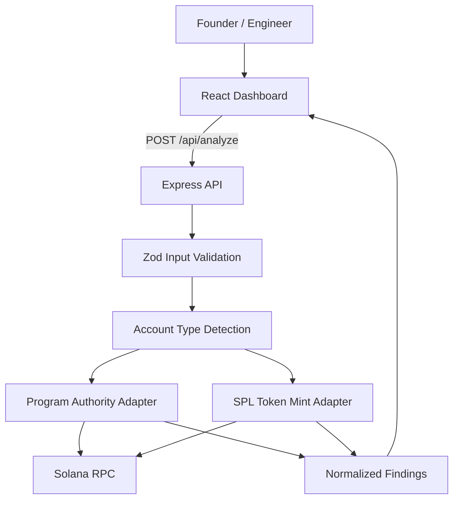

# Architecture

## Overview

## Boundaries

### Web
- Collects a public address and requested analysis type.
- Renders server-returned findings.
- Does not hold RPC credentials.
- Does not sign transactions.

### API
- Validates input.
- Queries the configured Solana RPC endpoint.
- Detects supported account types.
- Runs deterministic rules.
- Returns normalized evidence and limitations.
- Must fail closed if an account layout is unknown.

### RPC
- Source of observed account state.
- RPC data is not a guarantee of future state.
- Provider availability and rate limits can affect results.

## Data flow

1. User submits an address.
2. API validates request shape and public key format.
3. API reads the account from the selected cluster.
4. Analyzer identifies a supported program or mint.
5. Adapter decodes only documented, tested fields.
6. Rule engine generates findings with evidence.
7. UI displays observation time, cluster, limitations, and recommendations.

## Trust boundaries

- Browser to API: untrusted user input.
- API to RPC provider: external dependency; timeouts and malformed responses must be handled.
- On-chain metadata: public but not necessarily sufficient to infer the ultimate controller.
- UI report: advisory output, not an audit certificate.

## Future services

Add a database only when saved projects, snapshots, change history, users, or subscriptions are implemented. Avoid adding a database just to support the first demo.
